# Deadlock Rigs

A Blender add-on that builds animation rigs of Deadlock heroes, NPCs and maps from your own game install.

## Features

- Every hero, their transformed forms (Silver's werewolf, Calico's cat, Baba's pigeon, Ivy's stone form) and the NPCs
  (patrons, Guardians, Walkers, Mid-boss, troopers)
- IK/FK arms and legs, foot roll, torso and head controls, tails, hand poses
- Face rigs with expressions and lip sync shapes for most heroes
- Hair and cloth physics
- Weapons and props, plus the hero's extra models (Bebop's hook, Grey Talon's owl, Paige's dragon...)
- The game's animations: load any clip onto the rig, or insert it into your own animation
- Ability and clip particle effects added straight from the animations you load
- Midtown and the Hideout, lit like the game, with NPCs, ziplines and particles

| | |
|---|---|
|  |  |
| 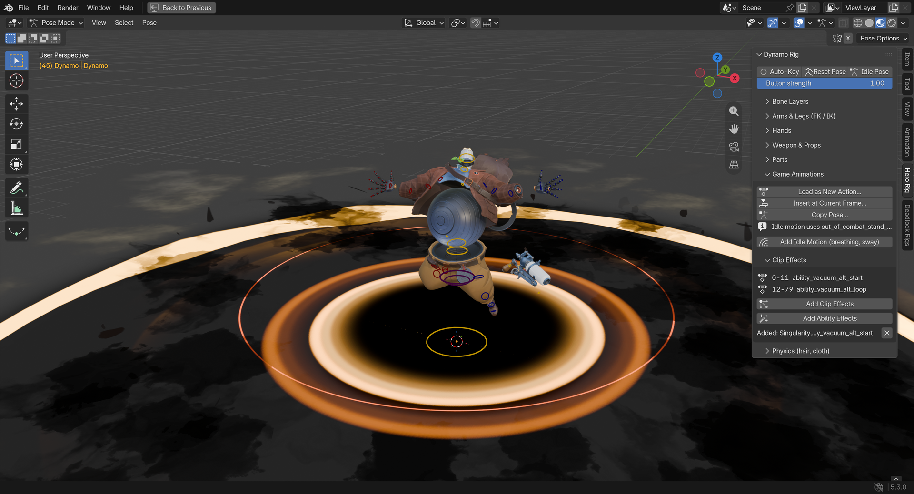 | 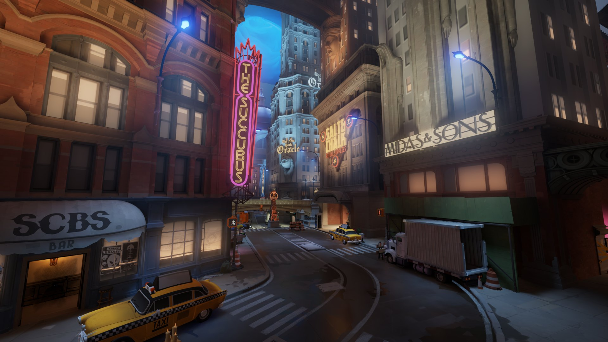 |

## Install

Needs Blender 5.1 or newer and Deadlock installed through Steam. Works on Windows, Linux and macOS.

1. Download the zip for your platform from [Releases](https://github.com/Sirsyorrz/deadlockrigs/releases).
2. In Blender: Edit > Preferences > Get Extensions > the menu at the top right > Install from Disk, then pick the zip.
3. Open the sidebar in the 3D View (N) > Deadlock Rigs, pick a hero and press Build Rig.

The first build downloads Source2Viewer-CLI (about 60 MB) to read the game files. Rigs are saved to
`Documents/DeadlockRigs/<hero>/`.

## Using a rig

- The rig's controls are in the sidebar under **Hero Rig**, in Pose Mode.
- **Export Animations** once per hero to get its game clips, then use **Game Animations** to load them.
- **Clip Effects** adds the particle effects for the loaded clips: Add Clip Effects for what the animation itself
  plays, Add Ability Effects for the ability's buffs, domes and auras.
- Opening a rig file without the add-on: allow "Run Python Scripts" so the panel loads.

## Maps

Midtown and the Hideout, built from your own install so they match your game version. They're lit the way the game
lights them, with its fog, moving textures, animated props, particles and post-processing.

| | |
|---|---|
| 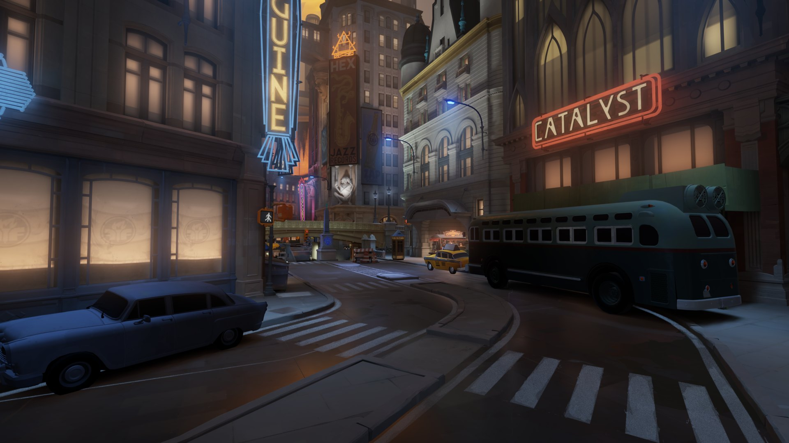 | 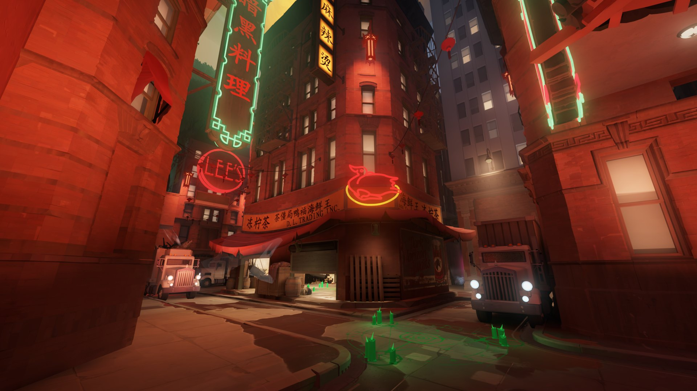 |
| 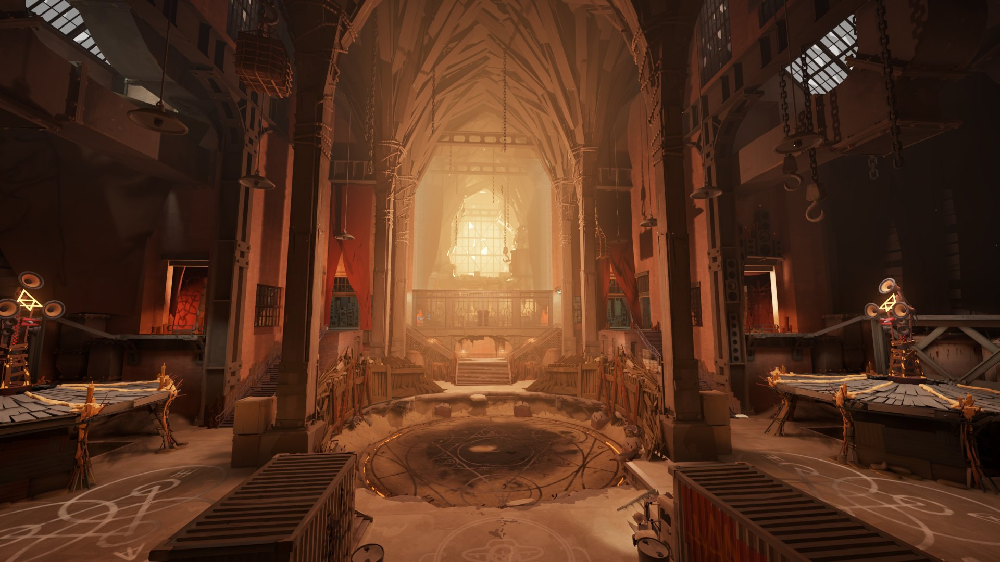 | 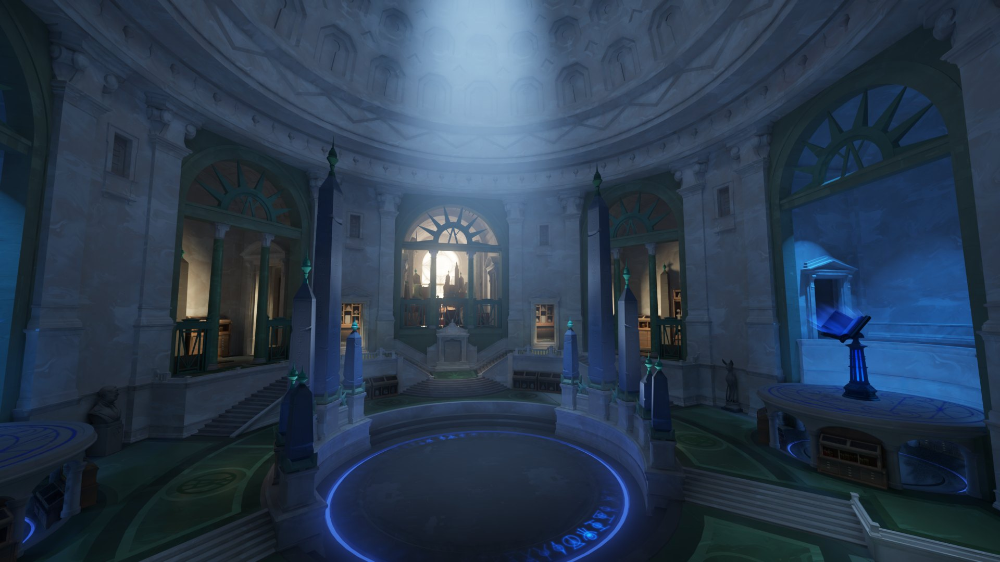 |
| 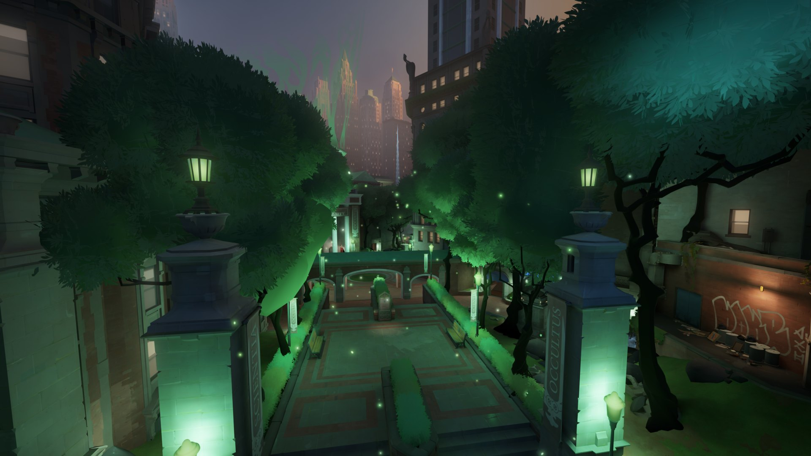 | 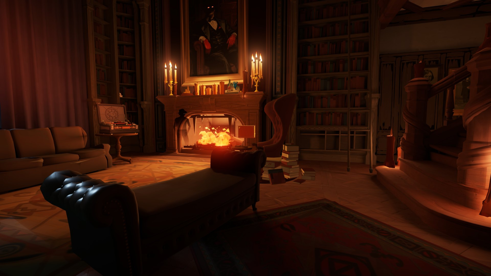 |
| 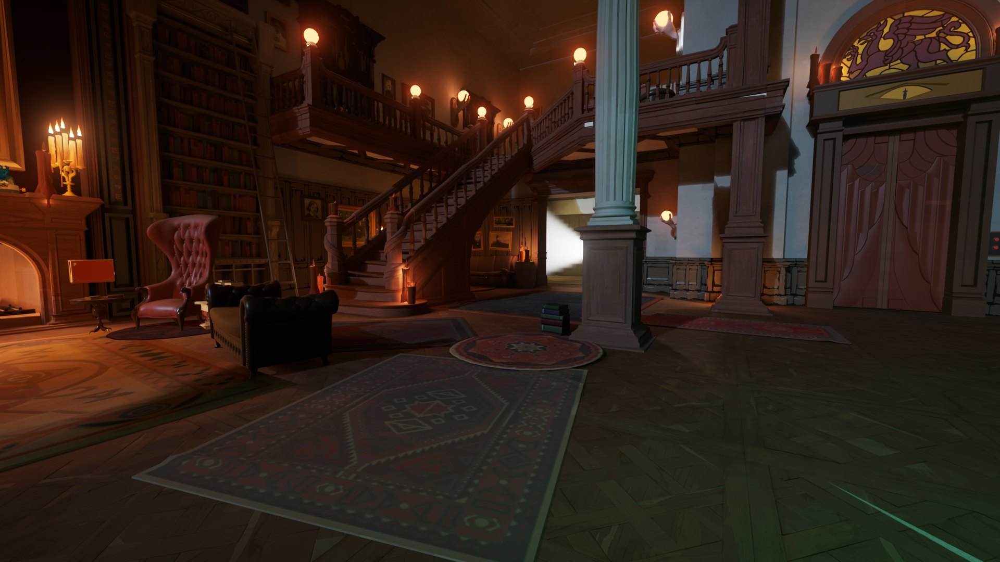 | 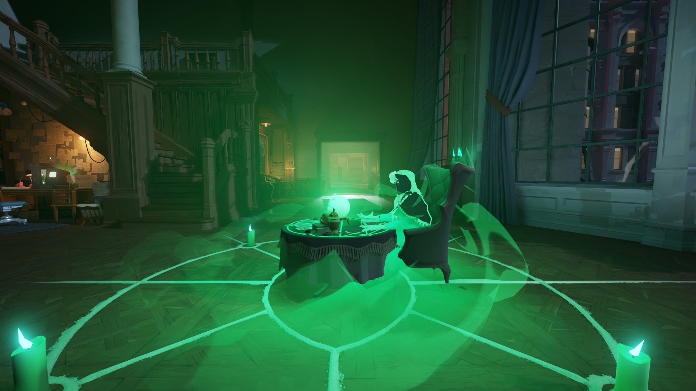 |

Under **Map** in the Deadlock Rigs panel: Build Map, then Link Map or Append Map to add it to your scene.

- Midtown takes about 20 minutes to build and needs about 12 GB of free RAM. The Hideout takes a couple of minutes.
- Midtown is big. Use **Crop** (to the camera or to boxes) before rendering.
- Mods you have installed that change map textures are included. Untick Include Mods for the stock map.
- With a map in the scene you can also add the game's NPCs and ziplines, and light your rigs from the map.

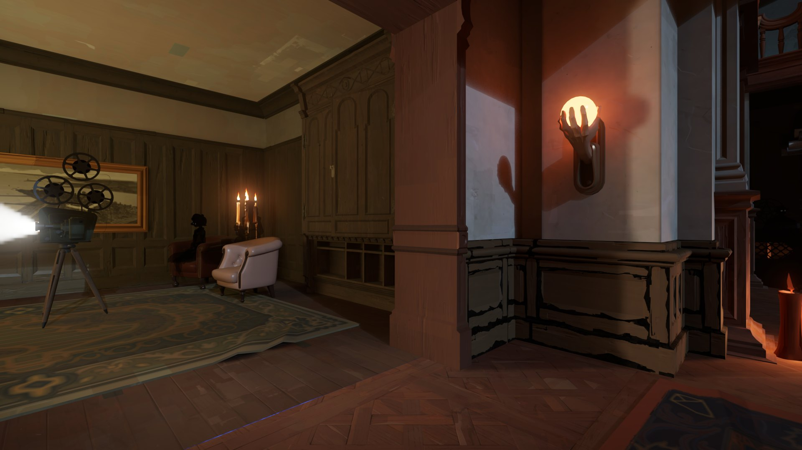

## Faces

Most heroes have a full face rig. A few have less:

- Bebop and Paradox: parts instead of a face (Bebop's jaw and monocle, Paradox's hourglass)
- Deadman Danny: jaw only
- Krill and Baba's pigeon: no face yet
- Dynamo, Seven and Sinclair: no face

## Help

Questions and bug reports: the [DeadlockForge Discord](https://discord.gg/DkwQ2baWfb). For build problems, turn on
"Keep build files" in the add-on preferences and send the build log (Show Build Log).

## Build from source

Needs Python 3 with numpy and scipy, Blender and Deadlock (both found through Steam).

    python tools/pipeline.py violet             # build one hero
    python tools/pipeline.py --help             # steps and options
    python tools/release.py addon               # package the add-on zips into dist/

## Credits

- Miruneko, [Deadlock Map Optimizer](https://github.com/Miruneko0/Deadlock-Map-Optimizer): the idea behind Crop.
- spenzo: his Blender port of Midtown and merging its objects.
- Divined, Deadlock Bridge: particle simulation and shading (`tools/deadlock_bridge`, GPL-3.0-or-later).
- [Cravvnn](https://github.com/cravvnn), [RenderLock](https://github.com/cravvnn/RenderLock): Source 2 lighting in
  Blender.
- [Source 2 Viewer / ValveResourceFormat](https://github.com/ValveResourceFormat/ValveResourceFormat): map export and
  the shaders the map lighting is ported from.

## License

GPL-3.0-or-later. Source2Viewer-CLI is from
[Source 2 Viewer](https://github.com/ValveResourceFormat/ValveResourceFormat) (MIT).
