# Deadlock Rigs

Blender animation rigs for Deadlock heroes built into blender.

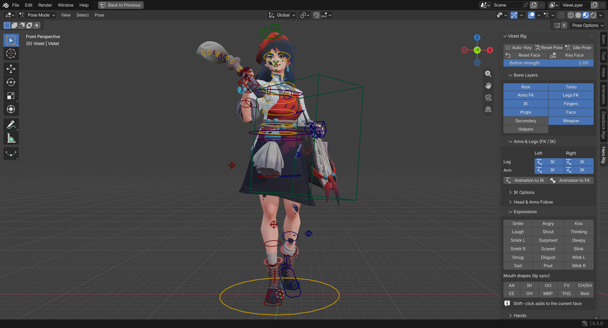

Each hero gets a rig with:
- IK/FK arms and legs, with soft IK, stretch, and switchable parents for the IK hands, feet and poles
- feet that roll on the heel, ball and toe tip, bank onto either edge and swivel (the arc behind the heel), with an
  IK ankle control that turns the foot on its own and an IK toe control
- torso, hips and chest controls on top of the FK spine
- head and FK arms that can keep their own angle instead of following the body
- the game's twist bones and cloth/hair physics, including coats
- tail controls for heroes with tails
- hand poses
- controls for the skeletons riding the hero: Baba on her bench, Mo on Krill, Rat King's rats (IK/FK limbs, own root)
- weapons held in hand by default (the `weapon_hold` property; loading a game clip switches it off); Solomon's board
  floats with his body instead
- an FK jaw (and eyes) for heroes without a face rig whose jaw is skinned (Deadman Danny)
- a Parts panel with the game's mesh switches (Rat King's banner, ammo and guard rats, Bebop's arm as hand, gun or
  forearm), sliders for animated parts (Bebop's gun folding open and its hyperbeam mode) and extra models the hero
  uses (Bebop's fired hook hand and sticky bomb), each with its own control, and a Glow slider for self-lit parts
  (Bebop's eyes, Rat King's eyes, Infernus' arm)
- the game's moving materials: textures that scroll and vertices that flicker as the timeline plays (Infernus' arm
  and hair flames, Haze's smoke, Geist's arms, Mirage's djinn)
- jointed hard-surface parts where the game has them fused to one bone (Bebop's jaw, monocle and head switches)
- face shape keys, controls and expressions for the heroes listed under [Faces](#faces)

NPCs are in the list too, under NPCs: the Guardian, Walker, Base Guardian, Mid-boss, Hidden King, Archmother and the
ranged, melee and medic troopers of both teams (Amber and Sapphire). They get the same controls for whatever their
skeleton has (the Mid-boss' five arms, the Walker's four legs, the patrons' lower body as a tail). The Base Guardian
gets foot and knee controls that its pistons follow, and a turret aim target.

| | |
|---|---|
| 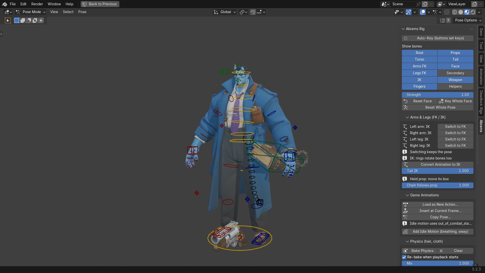 | 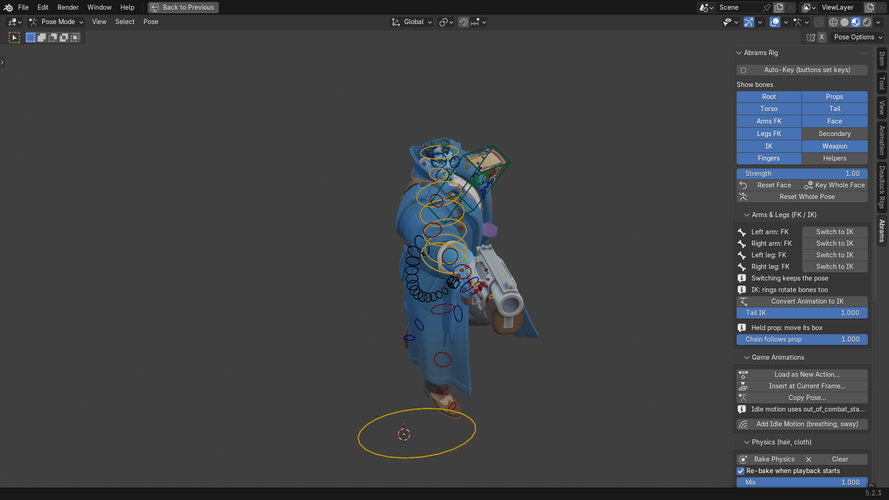 |
| 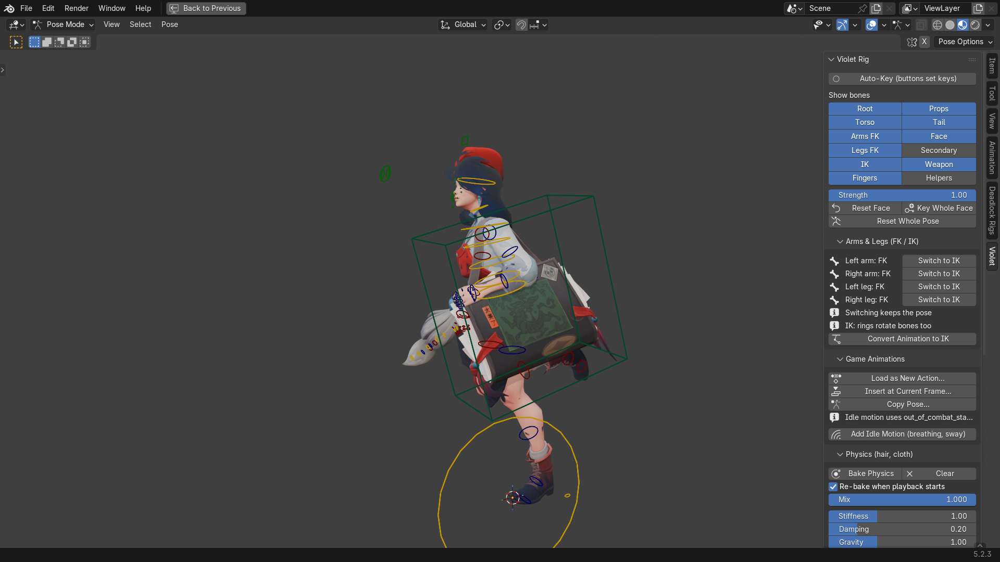 | 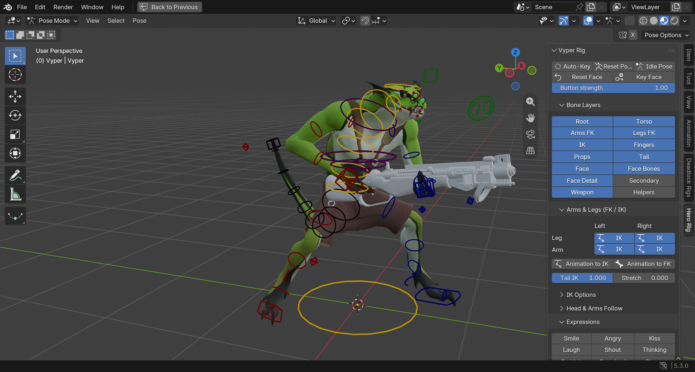 |

## Install

Needs Blender 5.1 or newer and Deadlock installed through Steam. Works on Windows, Linux and macOS.

1. Download the zip for your platform from [Releases](https://github.com/Sirsyorrz/deadlockrigs/releases).
2. In Blender: Edit > Preferences > Get Extensions > menu at the top right > Install from Disk, and pick the zip.
3. Open the 3D View sidebar (N) > Deadlock Rigs, pick a hero and press Build Rig.

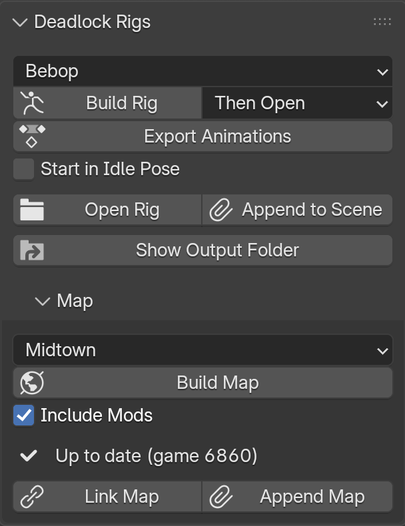

The first build downloads Source2Viewer-CLI (about 60 MB) to read the game files. A build takes one to three
minutes. Rigs are saved to `Documents/DeadlockRigs/<hero>/<hero>_rig.blend`, and rebuilding keeps the previous rig as
`<hero>_rig.old.blend`.

Export Animations saves all of the hero's game animations as `<hero>_animations.glb`, and as `<hero>_anims.blend`
next to the rig. With that file there, the rig gets a Game Animations panel to load clips as actions, insert them at
the current frame, copy a pose, or layer the idle's breathing on top. Keep it next to the rig file.

The rig's controls are in the sidebar under the Hero Rig tab, in Pose Mode. With several rigs in a scene the panel
follows the selected rig (or the selected hero's mesh). If you open a rig file without the add-on, allow "Run
Python Scripts" so that panel loads.

Settings are in Preferences > Add-ons > Deadlock Rigs: output folder, Deadlock folder (found through Steam when
empty), an existing Source2Viewer-CLI, saving the model as `.glb`/`.fbx` too, and keeping build files for bug reports.

## Maps

The Map section of the panel builds Midtown or the Hideout from your own install, so it matches your game version.
Build Map exports the map with Source2Viewer and merges its ~30,000 objects into one mesh per 100 m cell and material
(same triangles, material UVs and materials), then saves `Documents/DeadlockRigs/maps/<map>/<map>.blend` with
`textures` and `lightmaps` folders next to it. Midtown takes about 11 minutes and needs about 12 GB free while
building; the result is about 3.5 GB. The panel shows when a game update has made the map outdated, and building again
skips an up-to-date map.

**Mods.** Mods you have installed for Deadlock (in its `addons` folders, as mod managers put them) that replace map
textures, such as posters and signs, are in the built map like they are in the game. Turn off Include Mods in the Map
section and rebuild for the map as Valve ships it.

Link Map and Append Map add the map's collection to the open scene, make the map's sky the scene's world and put the
game look on the scene. The map is at its game position; rigs are at the origin, so move the rig or the map.

Link Map takes seconds: the map stays in its own file and your file points at it, so it can't be edited (moved,
materials, the node group values below) and the map's folder has to come along when the project moves. Append Map
copies the map into your file so all of it can be edited, but Blender stops responding for several minutes while it
appends (about 5 for Midtown).

**Lighting.** The map is lit the way the game lights it, from its own files: surfaces with lightmaps get the baked
lightmap, props get the map's light probe volumes (sampled per vertex when the map is built), unlit materials show
their colour as is, and signs and windows glow at the game's self-illumination strength. The baked light is emission
on top of each material, so lights you add still light the map; its strength is the Baked light strength value in the
`Deadlock baked light` node group. The map's sun comes in at the game's strength (the Hideout's); where the game has
none (Midtown), a Sun light from the game's sun direction lights only the rigs. The map's distance and height fog
are in the `Deadlock fog` node group (Fog strength), and the sky is the scene's world, seen by the camera only.

**Motion.** What moves in the game moves in the map, at the game's speed in seconds whatever the scene's frame
rate: textures that scroll (screens, smoke, film, string lights), surfaces whose vertices sway or wobble (smoke
cards, curtains, leaves, flags, ghosts) and props that loop an idle animation (the Hideout's ghosts, projector,
reel-to-reel, gramophone, the computer's spinning pentagram). It plays, scrubs and renders with no baking. Swaying
meshes have a `Deadlock motion` geometry nodes modifier; the props are in the map's `animated props` collection,
each an armature with its idle clip on repeat.

**Particles.** The map's particle effects (candle flames, the fireplace, Midtown's street steam and crows) are built
from the game's files with the map and play with the timeline: each effect is simulated from a few seconds in, once
it has settled, and baked into a seamless loop of 2 to 6 seconds at the game's speed, whatever the frame rate. Their
sprites and trails turn to the camera and are shaded like the game's particle shader, lit by the map's light probes
and dimmed by its fog; effects that draw models (the steam puffs) fade and wobble as the game's do. They are in the
map's `particles` collection, each effect an empty holding its parts. Particle Effects in the Map section places any
of the game's ~18,000 effects at the 3D cursor (type words of its path to search), looping, playing once from the
current frame (bursts, explosions) or as a still at its busiest moment or a time you set, and Rebuild simulates a
selected effect again at another time or seed. Light-only effects, projected decals, the game's extra bloom on some
materials and a few rarer operators aren't drawn.

**Rig light.** Rigs are lit from the map's light probes per pixel, as the game lights heroes, so they pick up the
room they stand in and follow it as they move. Linking or appending a map does this for the rigs in the scene, and so
does appending a rig to a scene with a map; Light Rigs (Map section) does it by hand, next to its Strength. It is
emission on top of the rig's materials, like the map's baked light. In Cycles the map's baked light also bounces onto
rigs, so lower Strength there if they look too bright. Maps built before this need a rebuild.

**Game look.** Adding a map puts the game's post-processing on the scene: its compositor gets the game's exposure,
filmic curve, bloom and vignette, and the view transform is set to Standard. That is most of what makes a render look
like Deadlock rather than Blender. Bloom and Vignette in the Map section set their strength.

**Crop.** With a map in the scene, the crop section can cut it down to what a shot needs, which makes the viewport and
renders much faster: Add Crop Box and Crop to Boxes keep what is inside the boxes, Crop to Camera keeps what the scene
camera sees over the frame range. Objects across the edge keep the polygons that reach in; particle effects stay whole
when any of their particles is inside. The Keep dropdown picks
map parts that are never cropped (skyline buildings, sky clouds, smoke, fog planes). Restore Map undoes it; Delete
Cropped removes the cropped parts for good to make the file smaller. A linked map crops the same way: the map's
collection is hidden and a `(cropped)` collection next to it holds what is kept, with the cut objects as local
copies.

## Help

Questions, bug reports and requests: the [DeadlockForge Discord](https://discord.gg/DkwQ2baWfb). When reporting a
build problem, turn on "Keep build files" in the add-on settings and include the build log (Show Build Log).

## Faces

| Hero | Face rig |
|---|---|
| Abrams, McGinnis | yes (from the game's face bones) |
| Apollo, Calico, Celeste, Drifter, Graves, Grey Talon, Holliday, Infernus, Kelvin, Lady Geist, Mina, Mirage, Nurse Harrow, Paige, Pocket, Silver, Solomon, The Doorman, Venator, Vindicta, Violet | yes |
| Billy, Rem, Victor | yes (from the game's face morphs) |
| Mo & Krill | Mo yes; Krill's eyes are under his cap, not yet |
| Baba | the rider yes (her eyes sit behind opaque lenses); the pigeon no |
| Ivy, Rat King, Vyper | yes (hand-made, with a bone face) |
| Viscous | yes (hand-made: his painted eyes blink, squint, widen, look and tilt; the goo squashes and stretches) |
| Haze, Lash, Shiv, Warden, Wraith, Yamato | yes (painted eyes: the lids squash the paint, the iris slides to look) |
| Bebop, Paradox | parts instead (Bebop's jaw, monocle and switches; Paradox's hourglass) |
| Deadman Danny | jaw only (his skull is behind goggles) |
| Dynamo, Seven, Sinclair | no (a cylinder head with glasses; a helmet; a blank mask) |

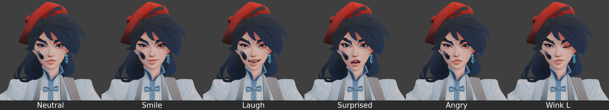
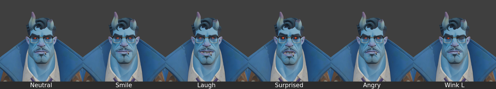

| | |
|---|---|
| 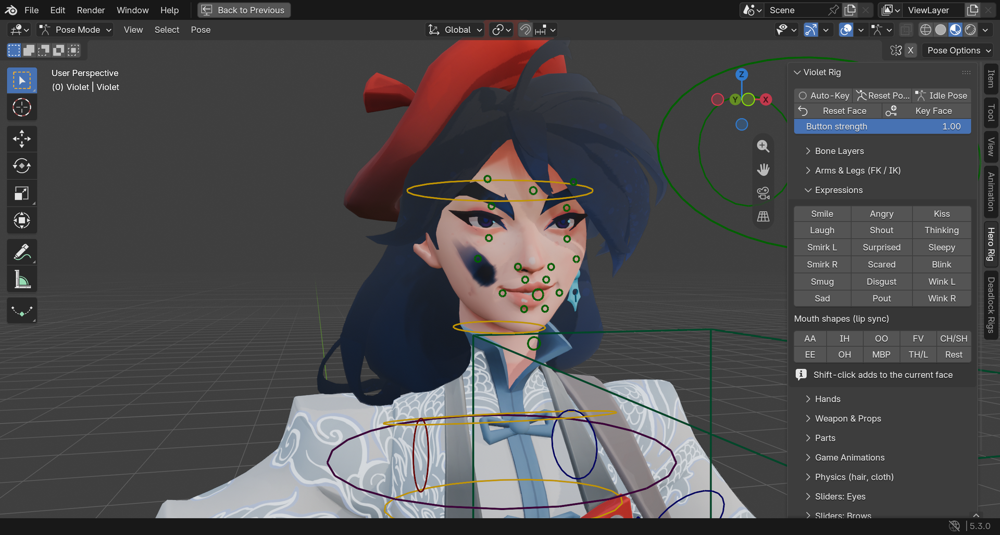 | 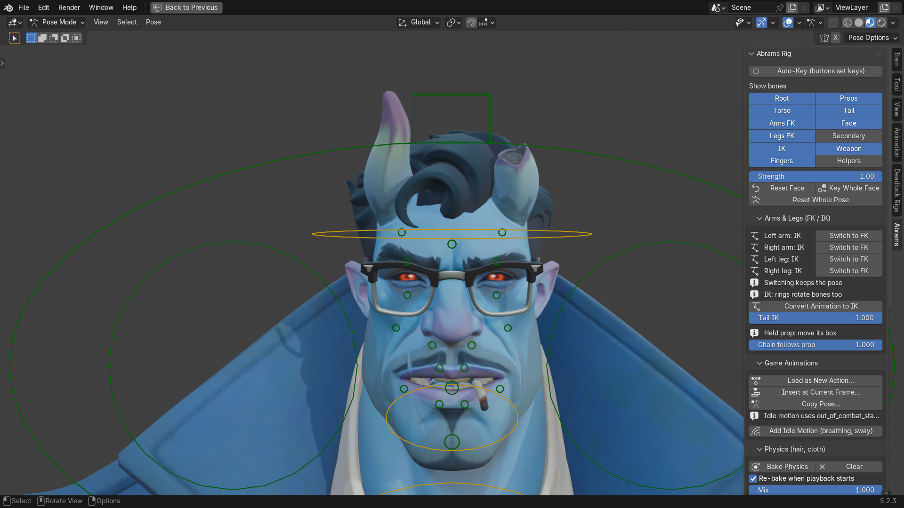 |

## Hands

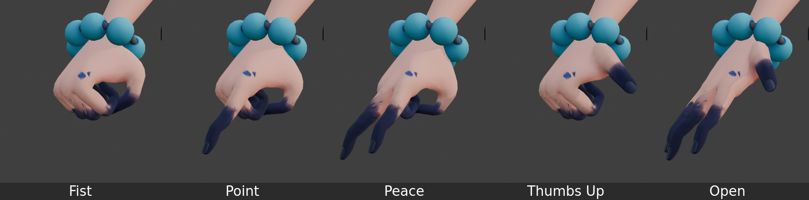

## Known gaps

- Sinclair's arm twist doesn't fully match his game animations.
- Mo & Krill get no hand poses (the skeleton lacks the finger bones).

## Build from source

The add-on runs `tools/pipeline.py`, which also works on its own. It needs Python 3 with numpy and scipy, Blender and
Deadlock; Blender and Deadlock are found through Steam, or pass `--blender` and `--pak`.

    python tools/pipeline.py violet             # build one hero
    python tools/pipeline.py all dev            # every hero, with the animation library and tests
    python tools/pipeline.py --help             # steps and options

Per-hero settings live in `heroes.json`.

To package the add-on yourself you need Python 3 with pip (or `uv`), Blender 5.1 or newer (found through Steam, or
set `BLENDER` to its path) and internet access for the scipy wheels. Deadlock isn't needed for this.

    git clone https://github.com/Sirsyorrz/deadlockrigs
    cd deadlockrigs
    python tools/release.py addon               # or: addon patch|minor|major|X.Y.Z to bump the version first

This writes `dist/deadlock_rigs-<version>-<platform>.zip` for Windows, Linux and macOS (Apple silicon and Intel).
Install the one for your platform as under [Install](#install).

## Credits

The map tools follow work by others in the Deadlock community:

- Miruneko (m1ru_neko), [Deadlock Map Optimizer](https://github.com/Miruneko0/Deadlock-Map-Optimizer): its Map Crop
  add-on showed cropping a map to boxes or the camera, which our Crop is modelled on.
- spenzo: his Blender port of Midtown, and merging the map's objects so Blender can handle it, which our map build
  does from your own install.
- Divined, Deadlock Bridge: the particle simulation and shading, and the model materials of particle effects, are his
  add-on's (in `tools/deadlock_bridge`, GPL-3.0-or-later), with a few changes to fit these maps.
- [Cravvnn](https://github.com/cravvnn), [RenderLock](https://github.com/cravvnn/RenderLock): research into using
  the game's Source 2 lighting in Blender.
- [Source 2 Viewer / ValveResourceFormat contributors](https://github.com/ValveResourceFormat/ValveResourceFormat):
  the map export, and the lightmap, light probe and fog shaders our map lighting is ported from.

## License

GPL-3.0-or-later. Source2Viewer-CLI is from [Source 2 Viewer](https://github.com/ValveResourceFormat/ValveResourceFormat)
(MIT).
