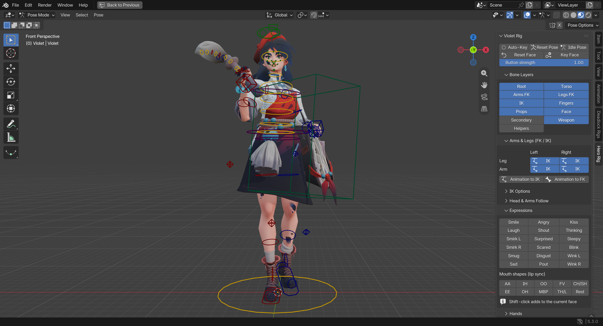
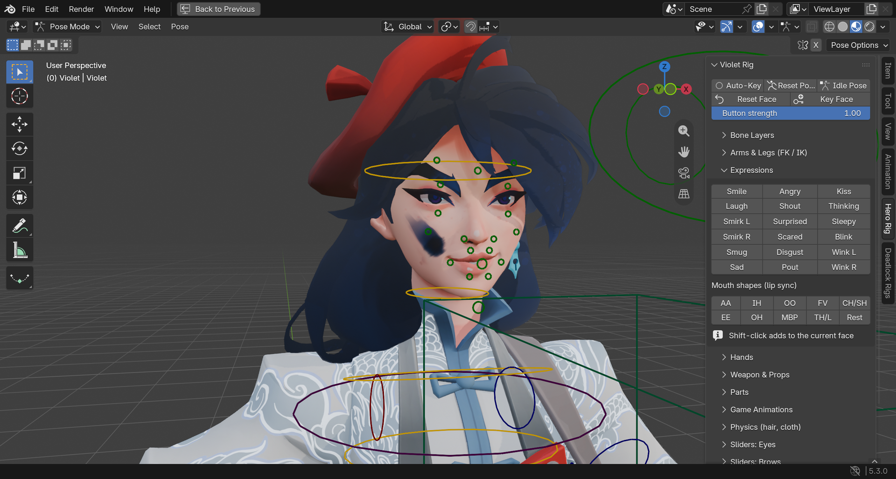
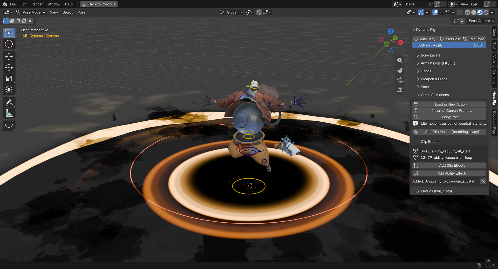
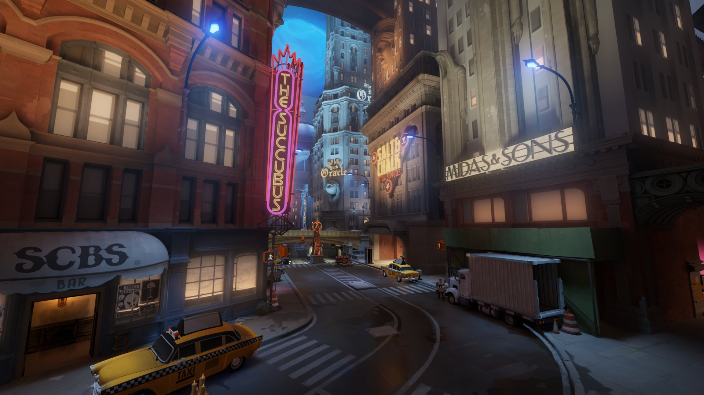

# Deadlock Rigs

A Blender add-on that builds animation rigs of Deadlock heroes, NPCs and maps from your own game install, and can
use Deadlock itself as a render engine.

## Install

Needs Blender 5.1 or newer and Deadlock installed through Steam. Works on Windows and Linux.

Open the **[install page](https://sirsyorrz.github.io/deadlockrigs/)** and drag the button for your platform into
Blender. Blender keeps the add-on up to date from then on.

Then open the sidebar in the 3D View (N) > Deadlock Rigs, pick a hero and press Build Rig.

## Rigs

Every hero, their transformed forms and the NPCs, with IK/FK limbs, hair and cloth physics, weapons and props. Load
the game's animations onto them, with the particle effects the animations play.

Most heroes also get a face rig: on-face controls for the brows, eyelids, eyes, mouth and jaw, built on
ARKit-style shape keys, with one-click expressions (smile, angry, surprised...) and lip sync mouth shapes to start
from. A few heroes have a partial face or none; the [Rigs guide](docs/rigs.md#faces) lists them.

**[Rigs guide](docs/rigs.md)**

| | |
|---|---|
|  |  |

## Maps

Midtown and the Hideout, built from your install and lit like the game, with NPCs, ziplines and particles.
Midtown is big: it takes a while to build and uses a lot of memory, so crop it down before working in it.

**[Maps guide](docs/maps.md)** (includes memory use and cropping)

## Deadlock Render Engine

A separate part of the add-on. Instead of rebuilding things in Blender, it starts Deadlock itself and uses the game
as the renderer: Blender drives the game's camera, and your rigs, game models and lights are drawn and lit by the
game. Runs as a local offline session (no matchmaking, no VAC).

**[Render engine guide](docs/render-engine.md)**

## Help

Questions and bug reports: the [DeadlockForge Discord](https://discord.gg/DkwQ2baWfb). For build problems, turn on
"Keep build files" in the add-on preferences and send the build log (Show Build Log).

## Credits

- Miruneko, [Deadlock Map Optimizer](https://github.com/Miruneko0/Deadlock-Map-Optimizer): the idea behind Crop.
- spenzo: his Blender port of Midtown and merging its objects.
- Divined, Deadlock Bridge: particle simulation and shading (`tools/deadlock_bridge`, GPL-3.0-or-later).
- [Cravvnn](https://github.com/cravvnn), [RenderLock](https://github.com/cravvnn/RenderLock): Source 2 lighting in
  Blender.
- [Deadlock Dolly](https://github.com/cravvnn/deadlock-dolly): the game offsets and camera decoding the render
  engine's bridge is built on (MIT).
- [Source 2 Viewer / ValveResourceFormat](https://github.com/ValveResourceFormat/ValveResourceFormat): map export and
  the shaders the map lighting is ported from.

## License

GPL-3.0-or-later. Source2Viewer-CLI is from
[Source 2 Viewer](https://github.com/ValveResourceFormat/ValveResourceFormat) (MIT).
