# Deadlock Rigs

Blender animation rigs for Deadlock heroes built into blender.

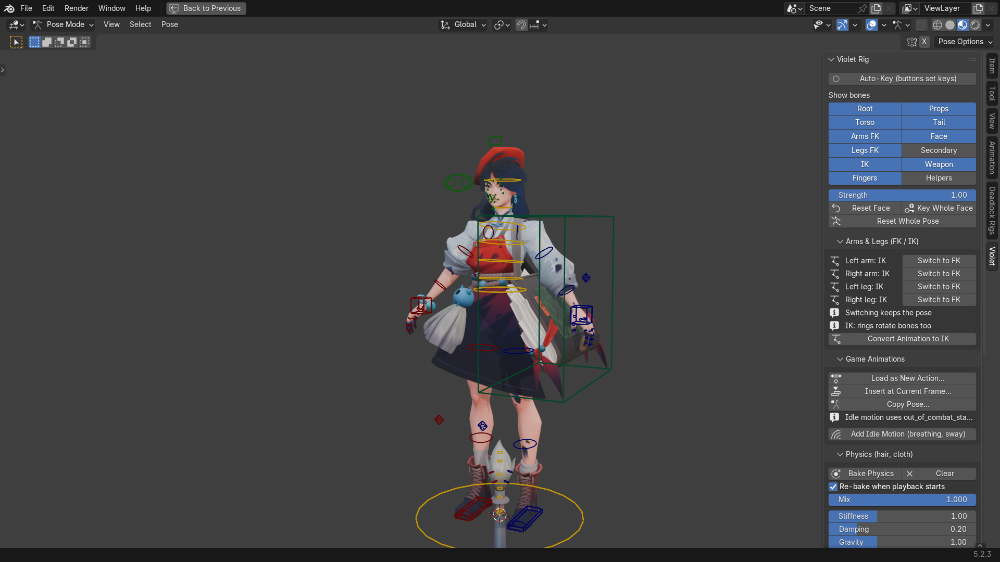

Each hero gets a rig with:
- IK/FK arms and legs
- the game's twist bones and cloth/hair physics, including coats
- tail controls for heroes with tails
- hand poses
- face shape keys, controls and expressions for the heroes listed under [Faces](#faces)

| | |
|---|---|
| 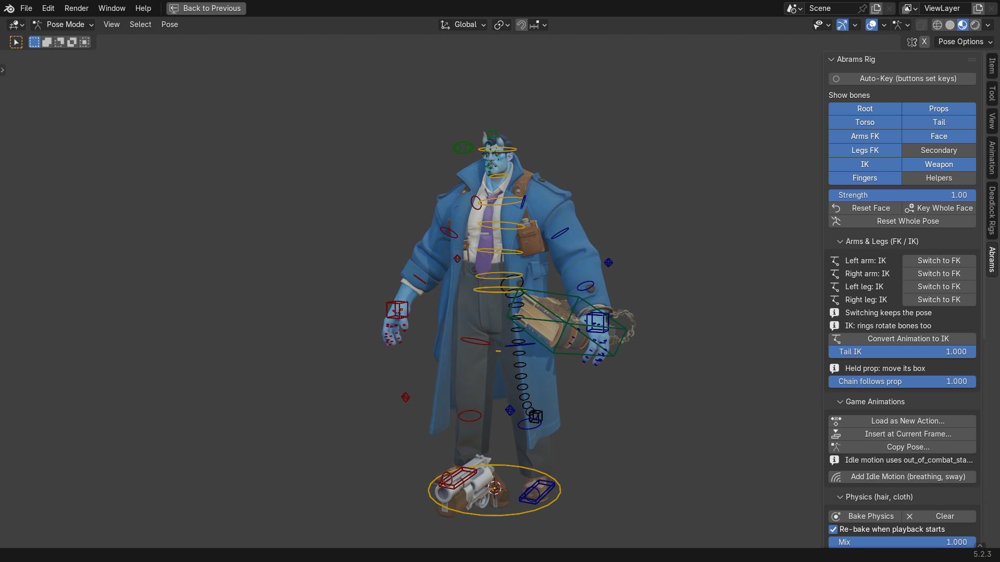 | 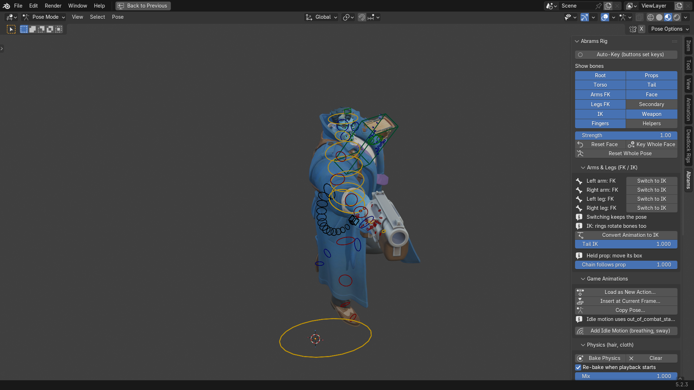 |
| 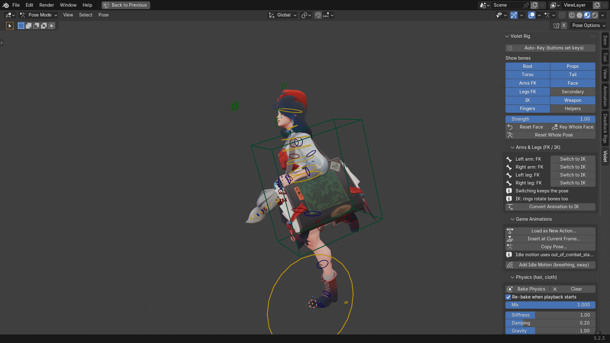 | 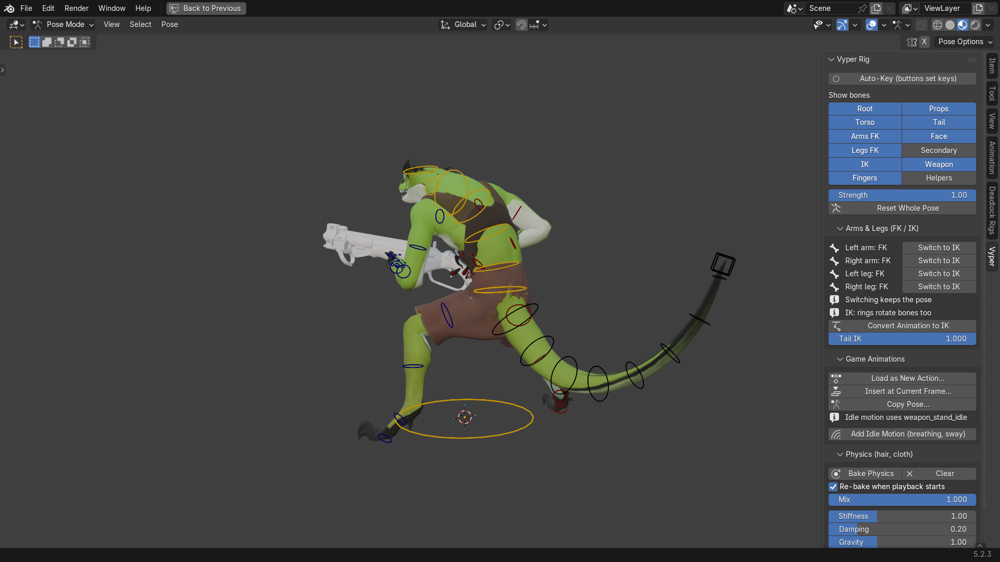 |

## Install

Needs Blender 5.1 or newer and Deadlock installed through Steam. Works on Windows, Linux and macOS.

1. Download the zip for your platform from [Releases](https://github.com/Sirsyorrz/deadlockrigs/releases).
2. In Blender: Edit > Preferences > Get Extensions > menu at the top right > Install from Disk, and pick the zip.
3. Open the 3D View sidebar (N) > Deadlock Rigs, pick a hero and press Build Rig.

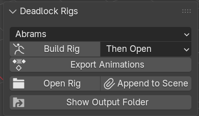

The first build downloads Source2Viewer-CLI (about 60 MB) to read the game files. A build takes one to three
minutes. Rigs are saved to `Documents/DeadlockRigs/<hero>/<hero>_rig.blend`, and rebuilding keeps the previous rig as
`<hero>_rig.old.blend`.

Export Animations saves all of the hero's game animations as `<hero>_animations.glb`, and as `<hero>_anims.blend`
next to the rig. With that file there, the rig gets a Game Animations panel to load clips as actions, insert them at
the current frame, copy a pose, or layer the idle's breathing on top. Keep it next to the rig file.

The rig's controls are in the sidebar under a tab named after the hero, in Pose Mode. If you open a rig file
yourself, allow "Run Python Scripts" so that panel loads.

Settings are in Preferences > Add-ons > Deadlock Rigs: output folder, Deadlock folder (found through Steam when
empty), an existing Source2Viewer-CLI, saving the model as `.glb`/`.fbx` too, and keeping build files for bug reports.

## Help

Questions, bug reports and requests: the [DeadlockForge Discord](https://discord.gg/DkwQ2baWfb). When reporting a
build problem, turn on "Keep build files" in the add-on settings and include the build log (Show Build Log).

## Faces

| Hero | Face rig |
|---|---|
| Abrams, McGinnis | yes (from the game's face bones) |
| Apollo, Drifter, Graves, Mina, Paige, Venator, Violet | yes |
| Billy, Rem, Victor | yes (from the game's face morphs) |
| everyone else | not yet |

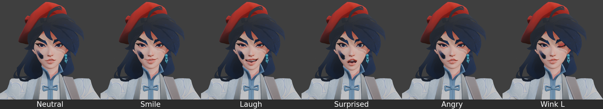
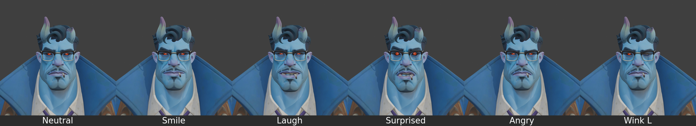

| | |
|---|---|
| 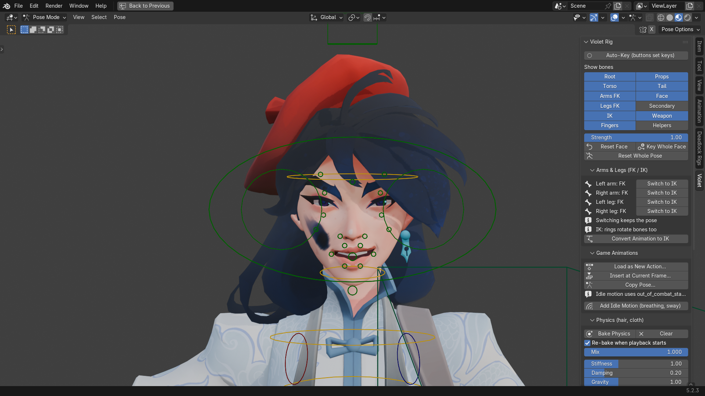 | 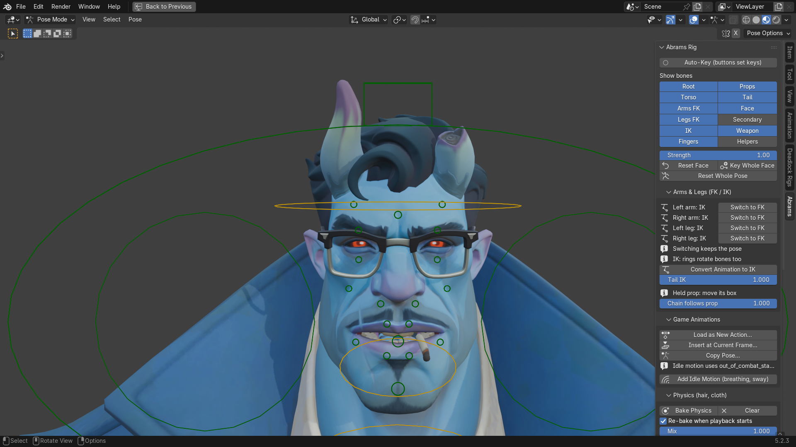 |

## Hands

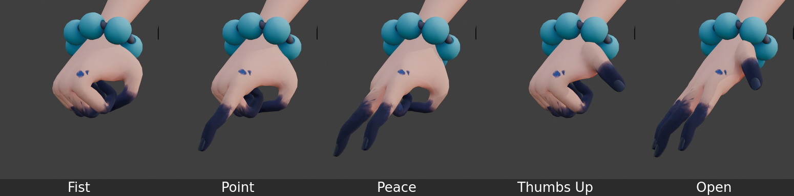

## Known gaps

- Sinclair's arm twist doesn't fully match his game animations.
- Baba only gets leg IK, and Bebop and Mo & Krill get no hand poses (their skeletons lack the bones).
- Limbs can't be stretched by hand in IK.

## Build from source

The add-on runs `tools/pipeline.py`, which also works on its own. It needs Python 3 with numpy and scipy, Blender and
Deadlock; Blender and Deadlock are found through Steam, or pass `--blender` and `--pak`.

    python tools/pipeline.py violet             # build one hero
    python tools/pipeline.py all dev            # every hero, with the animation library and tests
    python tools/pipeline.py --help             # steps and options

Per-hero settings live in `heroes.json`. `python tools/release.py addon` packages the add-on.

## License

GPL-3.0-or-later. Source2Viewer-CLI is from [Source 2 Viewer](https://github.com/ValveResourceFormat/ValveResourceFormat)
(MIT).
