# Maps

[Back to the README](../README.md)

Midtown and the Hideout, built from your own install so they match your game version. They're lit the way the game
lights them, with its fog, moving textures, animated props, particles and post-processing.

| | |
|---|---|
| 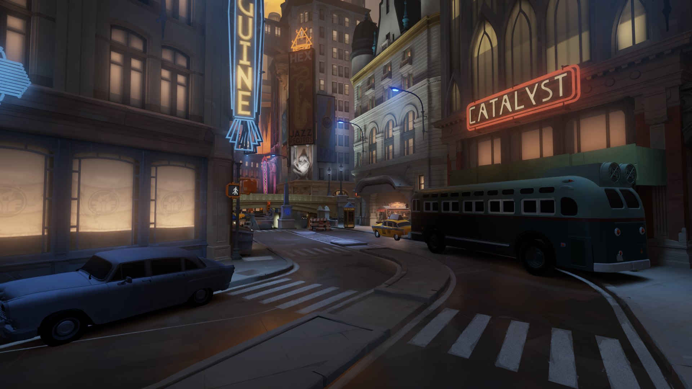 | 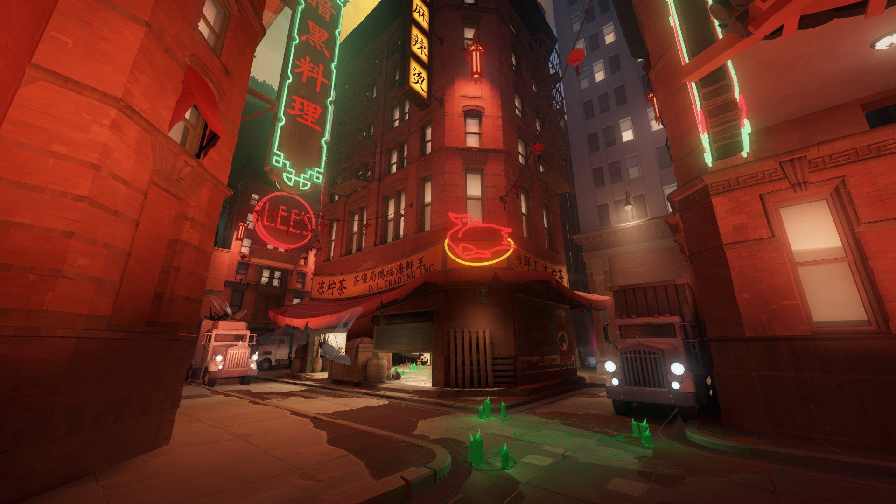 |
| 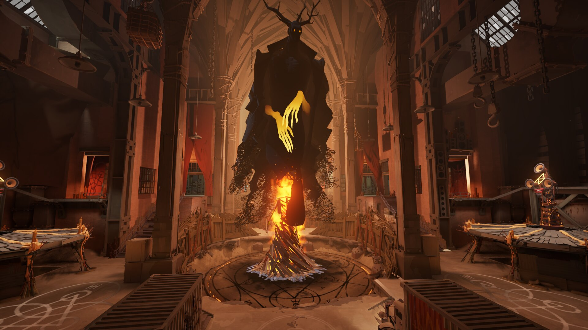 | 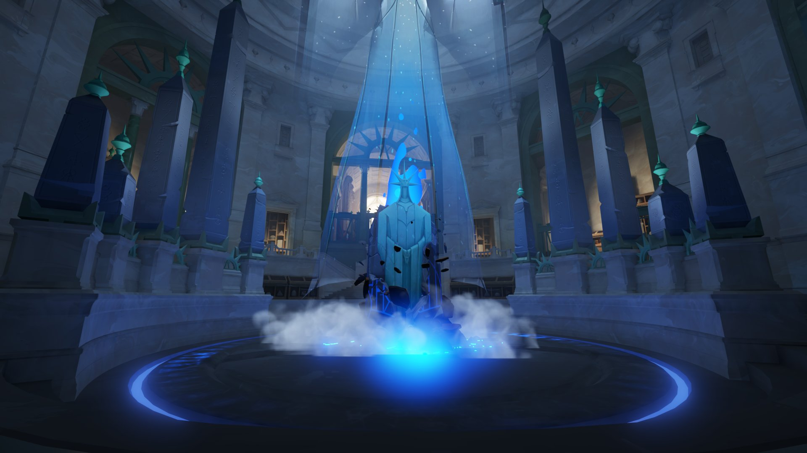 |
| 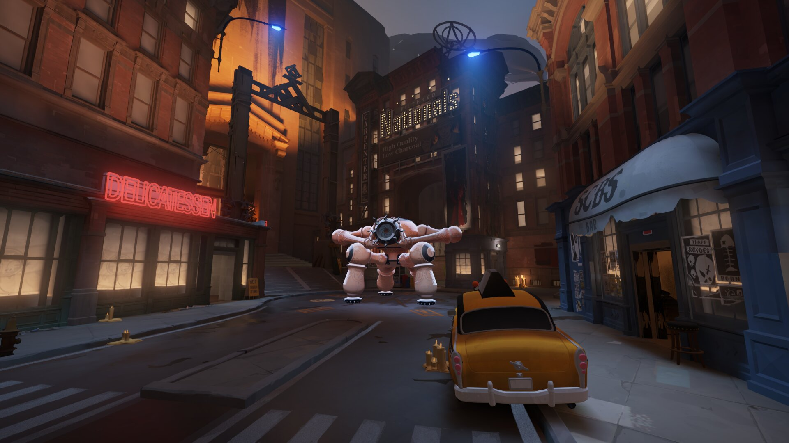 | 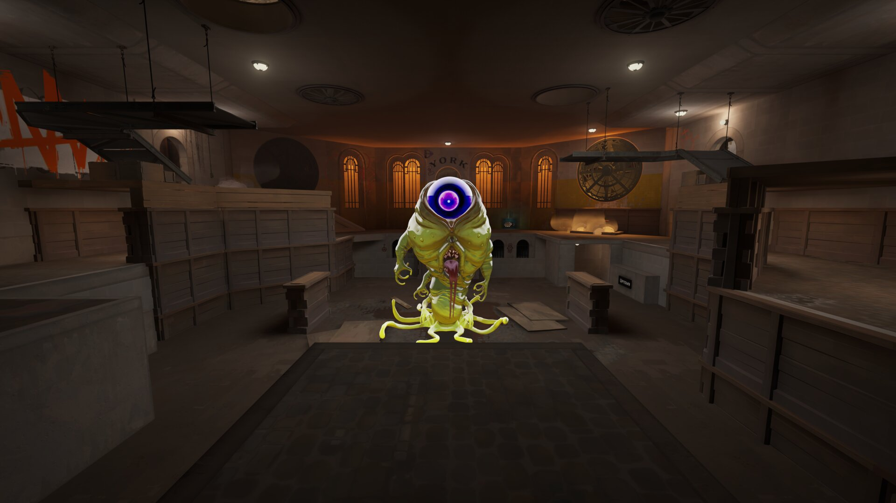 |
| 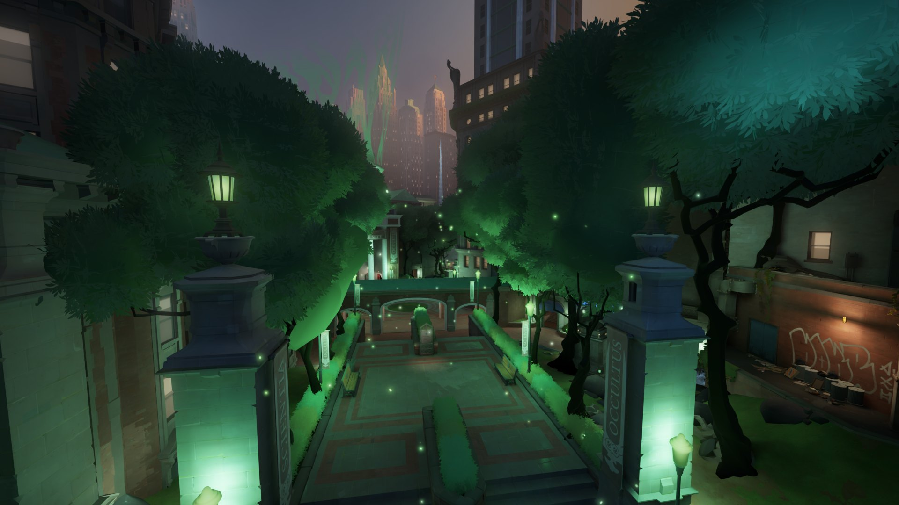 | 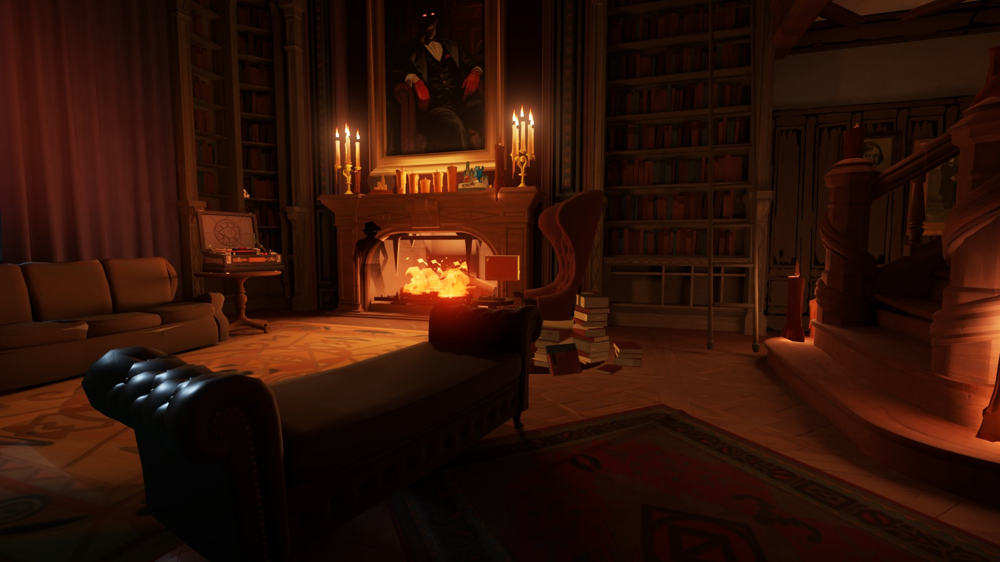 |
| 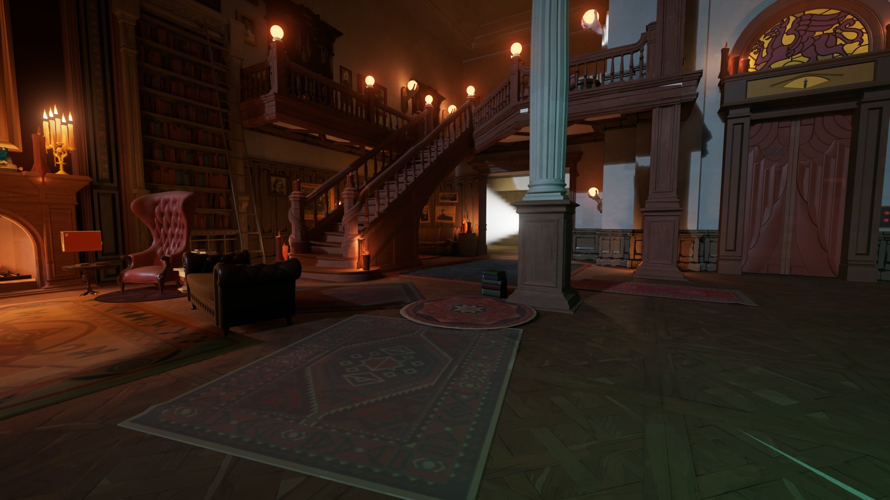 | 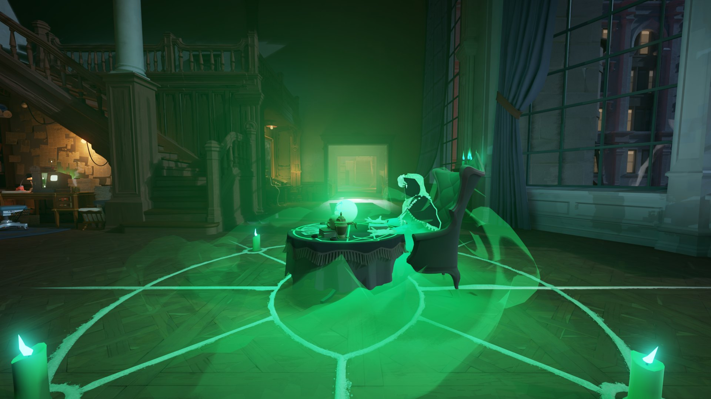 |

## Building and adding a map

Under **Map** in the Deadlock Rigs panel: pick the map and press Build Map. Then add it to your scene:

- **Link Map**: about 10 seconds. Lights, renders and crops the same, but can't be edited, and the file keeps
  pointing at the map in the output folder.
- **Append Map**: copies the map into the file so it can be edited. Blender stops responding while it appends
  (Midtown takes about 5 minutes).

Mods you have installed that change map textures are included. Untick **Include Mods** for the stock map.

With a map in the scene you can also add the game's **NPCs** and **ziplines**, and **Light Scene** lights your rigs
from the map.

## Memory and build time

| | Build | Build RAM peak | Open in Blender |
|---|---|---|---|
| Hideout | about 2 minutes | about 8 GB | about 3 GB, more once textures load |
| Midtown | about 20 minutes | about 19 GB | about 11 GB, more once it's drawn |

- Building Midtown peaks around 19 GB of memory. With less RAM it spills into the page file or swap: it still builds
  but takes longer, so make sure the page file or swap has room, and close the game, browsers and other heavy apps
  first. 32 GB builds it comfortably.
- If Blender closes or the system freezes during a build or render, it ran out of memory.
- Material Preview and rendering with full textures use a lot more than Solid view. Even the Hideout can reach about
  20 GB rendering uncropped at full texture size.
- **Viewport Textures** and **Render Textures** (in the Map panel) lower the texture size. The viewport
  defaults to 512 to save memory.

These figures were measured on one 32 GB machine; use them as a rough guide.

## Cropping

Cropping is the main way to make a map lighter, and Midtown should almost always be cropped.

- **Crop to Camera** hides what the scene camera never sees over the frame range.
- **Add Crop Box** + **Crop to Boxes** keeps only what's inside the boxes you place.
- **Restore Map** undoes a crop.
- **Delete Cropped** removes the hidden parts for good.

Hiding alone makes rendering and the viewport lighter, but the whole map is still loaded in memory. To actually cut
the memory a map takes:

1. **Append** the map (Delete Cropped doesn't work on a linked map: its hidden parts live in the map file, not yours).
2. Crop to Camera or Crop to Boxes.
3. **Delete Cropped**, then save.
4. Work in that file from now on. It only holds what you kept, so it opens faster and uses far less RAM.

The full map still has to be loaded once to crop it, so the memory peak happens at that first step.

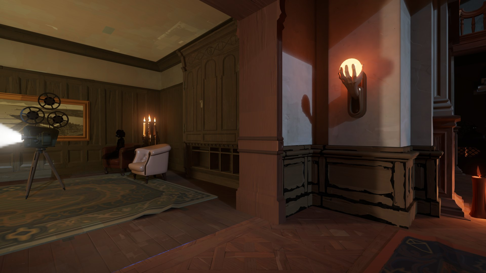
