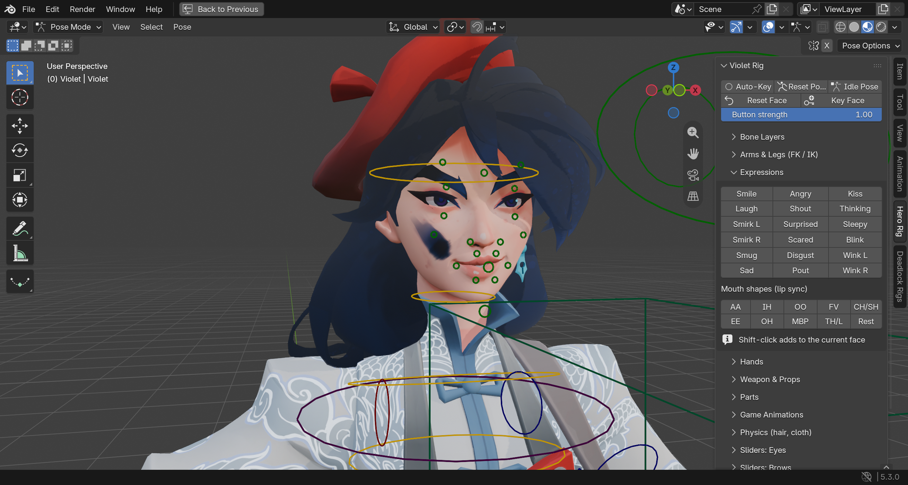
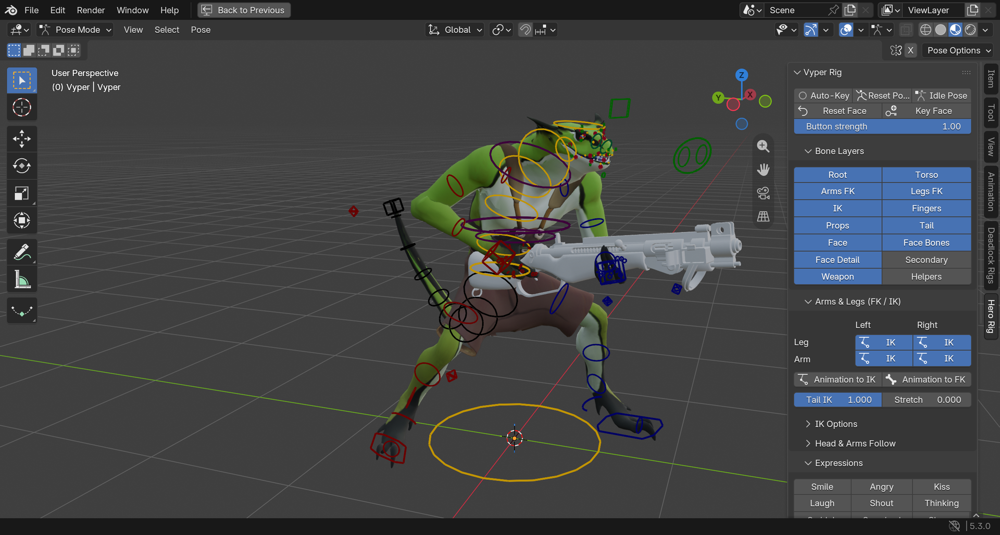
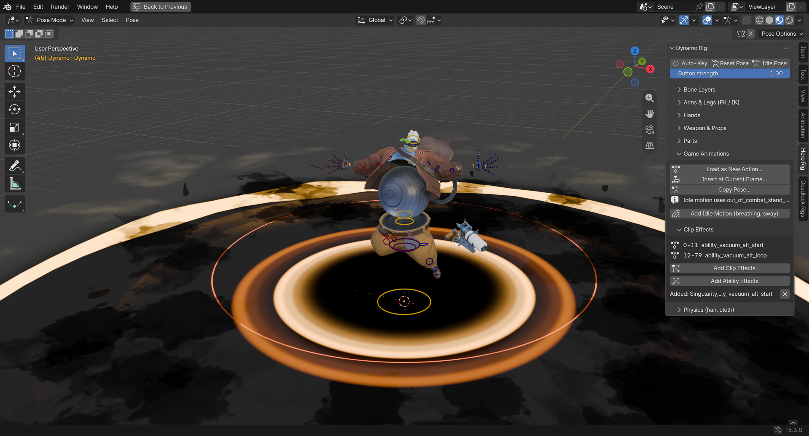
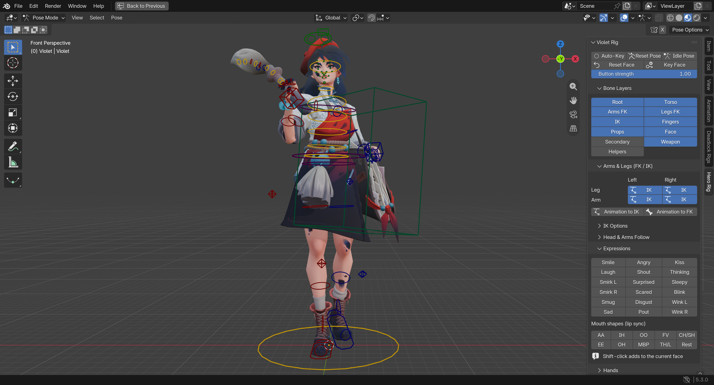
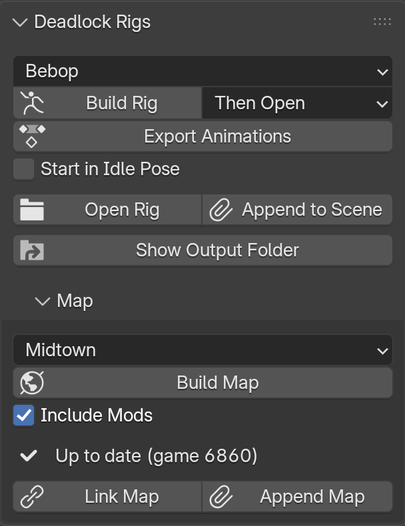
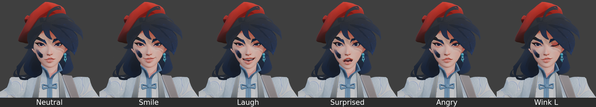
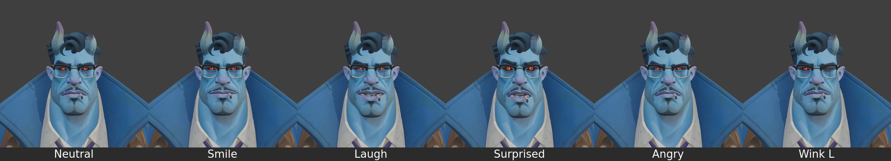
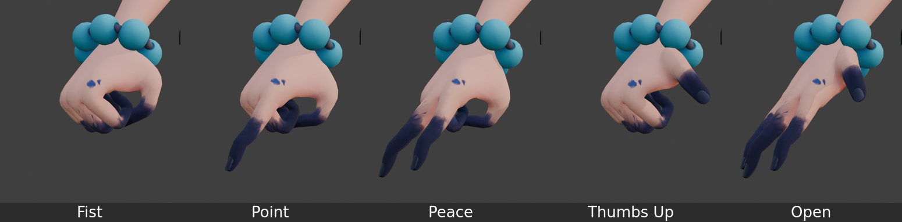

# Rigs

[Back to the README](../README.md)

## What you get

- Every hero, their transformed forms (Silver's werewolf, Calico's cat, Baba's pigeon, Ivy's stone form) and the NPCs
  (patrons, Guardians, Walkers, Mid-boss, troopers)
- IK/FK arms and legs, foot roll, torso and head controls, tails, hand poses
- Face rigs with expressions and lip sync shapes for most heroes
- Hair and cloth physics
- Weapons and props, plus the hero's extra models (Bebop's hook, Grey Talon's owl, Paige's dragon...)
- The game's animations: load any clip onto the rig, or insert it into your own animation
- Ability and clip particle effects added straight from the animations you load

| | |
|---|---|
|  |  |
|  |  |

## Building a rig

Open the sidebar in the 3D View (N) > Deadlock Rigs, pick a hero and press Build Rig.

The first build downloads Source2Viewer-CLI (about 60 MB) to read the game files. Rigs are saved to
`Documents/DeadlockRigs/<hero>/`.

After an add-on update, a rig that the update changes (new face, fixes, new toggles) shows "Built by an older add-on,
rebuild" under the hero list. Rebuild Rig keeps the previous one as `<hero>_rig.old.blend`.

## Using a rig

- The rig's controls are in the sidebar under **Hero Rig**, in Pose Mode.
- **Export Animations** once per hero to get its game clips, then use **Game Animations** to load them.
- **Clip Effects** adds the particle effects for the loaded clips: Add Clip Effects for what the animation itself
  plays, Add Ability Effects for the ability's buffs, domes and auras.
- Opening a rig file without the add-on: allow "Run Python Scripts" so the panel loads.

## Faces

Most heroes have a full face rig. A few have less:

- Bebop and Paradox: parts instead of a face (Bebop's jaw and monocle, Paradox's hourglass)
- Deadman Danny: jaw only
- Krill and Baba's pigeon: no face yet
- Dynamo, Seven and Sinclair: no face

## Hands

